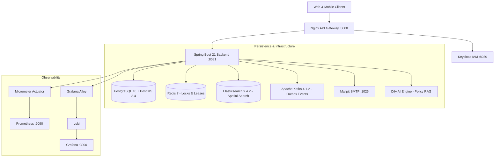

# ChargeOps — Backend Core Engine

> **Enterprise EV Charging Infrastructure, Spatial Booking & Operations Platform for Vietnam**  
> *BSc (Hons) Computing Final Year Project*

ChargeOps Backend is an enterprise-grade backend system powering an end-to-end electric vehicle (EV) charging network across Vietnam. Engineered with **Java 21** and **Spring Boot 3.4+ / Spring Modulith**, it coordinates high-throughput spatial discovery, transactional time-slot booking holds, multi-party refund accounting, real-time hardware telemetry, AI-driven policy retrieval (RAG), and event-driven notifications.

---

## 🏛️ System Architecture

ChargeOps follows a clean modular monolith architecture with event-driven integration patterns:



### Core Technology Stack

| Component | Technology | Role & Implementation Details |
|---|---|---|
| **Core Framework** | Java 21, Spring Boot 3.4+, Spring Modulith | Domain-driven modular architecture, transactional boundary control |
| **Relational Database** | PostgreSQL 16 + PostGIS 3.4 | Spatial queries (`ST_DWithin`, `ST_DistanceSphere`), spatial indexing (GIST) |
| **Distributed Cache & Locking** | Redis 7 | 10-minute booking slot holds, distributed lock coordination |
| **Search Engine** | Elasticsearch 9.4.2 | Real-time station discovery, multi-criteria filtering (connectors, power, pricing) |
| **Event Broker & Messaging** | Apache Kafka 4.1.2 (KRaft) | Transactional Outbox pattern, durable event delivery, notification decoupling |
| **Identity & Access Management** | Keycloak 26.0.8 (OAuth2 Resource Server) | Role-Based Access Control (Admin, Station Owner, Station Staff, Driver) |
| **Database Migrations** | Flyway (V1 - V60+) | Versioned, zero-drift schema evolution and seed data management |
| **AI & Knowledge Retrieval** | Dify Cloud / Self-hosted REST API | BKG-067 Policy Assistant RAG, quota management, conversation history recovery |
| **Observability & Telemetry** | Prometheus, Grafana, Loki, Alloy | Real-time health metrics, access logs, JVM heap & connection pool monitoring |
| **Testing** | JUnit 5, Testcontainers, MockMvc, AssertJ | Comprehensive integration and regression test coverage across all domain modules |

---

## ⚡ Core Domain Modules & Business Capabilities

### 1. 🧭 Spatial Station Discovery & Hardware Provisioning (`search` & `station`)
- **Spatial Discovery Engine**: High-performance spatial search matching EV driver location with compatible connectors (CCS2, Type 2, GB/T, CHAdeMO) within custom radii.
- **Hardware Topology**: Multi-level hierarchy: Station → Charge Points (AC/DC, kW capacity) → Connectors (Status: Available, Occupied, Faulted, Maintenance).
- **Driver Eligibility Engine (`isStationDriverEligible`)**: Strict business rule engine requiring both an `ACTIVE` physical station approval and a valid operator subscription license before publishing stations to driver discovery.

### 2. 📅 Booking Engine v4.9 (`booking`)
- **Time-Package Booking**: Fixed time-slot reservations eliminating queue anxiety at charging hubs.
- **10-Minute Hold Lock**: Atomically locks the requested connector and time range for 10 minutes during payment processing to prevent double-booking race conditions.
- **QR Check-in & Strict Cutoff Window**: Drivers must check in via connector QR code between `startAt` (inclusive) and `checkInDeadline` (default: `endAt - 15 minutes`). Unclaimed slots automatically transition to `CANCELLED` (`NO_SHOW`) at cutoff.
- **Hardware Session Simulation**: Virtual charging session lifecycle transitions (`CHECKED_IN` → `CHARGING` → `COMPLETED`) with telemetry metrics (kWh, power, duration).

### 3. 💰 Cancellation & Owner Finance Ledger (`refund` & `payment`)
- **BKG-067 Grace Window Policy**:
  - **Grace Period (10 minutes from payment confirmation)**: Drivers receive 100% full package refund upon cancellation before slot start and prior to check-in.
  - **Post-Grace / Voluntary Cancellation**: 0% refund (change of mind).
  - **No-Show Cancellation**: 0% refund.
  - **Verified Station Failure**: 100% full package refund when technical failure is substantiated by the Owner or granted by Platform Admin via dispute escalation.
- **Double-Entry Owner Ledger**: Tracks confirmed receivables, completed charges, refund liabilities, and net station earnings.
- **Simulator Execution & Replay Safety**: Idempotent refund attempts preventing duplicate transfers or inconsistent financial states.

### 4. 🤖 AI Policy Assistant & Knowledge Hub (`assistant` & `legal`)
- **BKG-067 RAG Integration**: Integrates with Dify API to answer operational and legal questions grounded on official bilingual policy documents (VI/EN).
- **Conversation History Recovery**: Endpoints to list historical conversation sessions and retrieve prior chat turns with cursor pagination.
- **Cost & Abuse Protection**: Strict Owner-role gating, daily query quotas (e.g., 20 queries/day), countdown to quota reset, and sanitization.
- **Document Management**: Multi-locale legal documents (Terms of Service, Privacy Policy, Operational Regulations).

### 5. 📬 Notification & Real-Time Delivery (`notification` & `infra`)
- **Transactional Outbox**: Booking cancellations and status updates write to the database outbox in the same local transaction, dispatched durably via Kafka.
- **Email Delivery**: Automated confirmation and cancellation notices dispatched to Mailpit/SMTP.
- **Real-Time WebSocket/STOMP**: Private user hint queues (`/user/queue/notifications`) notifying web and mobile clients of inbox changes without polling.

---

## 📂 Project Directory Structure

```
chargeops-backend/chargeops/
├── src/main/java/com/thang/chargeops/
│   ├── assistant/       # Dify RAG client, chat history proxy, quota evaluator
│   ├── booking/         # Time-slot bookings, hold locks, QR check-in, sessions
│   ├── incident/        # Station incidents, hardware troubleshooting
│   ├── infra/           # Kafka producer/consumer, WebSocket STOMP, mailer, Redis
│   ├── legal/           # Legal documents management, multi-lingual contracts
│   ├── location/        # Vietnamese administrative units (provinces, districts, wards)
│   ├── notification/    # Role-scoped notification inbox & preference settings
│   ├── payment/         # Simulator payment gateway, VNPay/MoMo integration contracts
│   ├── refund/          # Owner Ledger, refund dispute review, simulator attempts
│   ├── search/          # Elasticsearch geospatial indexing and query services
│   ├── station/         # Station lifecycle, charge points, connectors, license governance
│   └── support/         # Support tickets, dispute escalation, technical evidence
├── src/main/resources/
│   ├── db/migration/    # Flyway migration scripts (V1 through V60+)
│   ├── application.yml  # Base Spring Boot configuration
│   └── application-dev.yml # Local development configuration
├── docs/                # Architectural RFCs, walk-throughs, and Obsidian Knowledge Vault
├── observability/       # Prometheus, Grafana Alloy, and Loki configuration files
├── docker-compose.yml   # Multi-container dev lab (PostGIS, Redis, Kafka, ES, Keycloak, etc.)
└── pom.xml              # Maven dependencies and build lifecycle configuration
```

---

## 🚀 Getting Started

### Prerequisites
- **Java**: JDK 21 (Eclipse Temurin or Oracle JDK)
- **Maven**: 3.9+ (or use included `./mvnw`)
- **Docker & Docker Compose**: v2.20+
- **Node.js**: v20+ *(optional, for local toolchains)*

---

### 1. Environment Setup

Copy the example environment files and customize as needed:
```bash
cp .env.example .env
```

Key environment configurations:
- `POSTGRES_USER`, `POSTGRES_PASSWORD`, `POSTGRES_DB`: PostgreSQL credentials
- `REDIS_HOST`, `REDIS_PORT`: Redis cache settings
- `KAFKA_BOOTSTRAP_SERVERS`: Kafka broker connection
- `ELASTICSEARCH_URL`: Elasticsearch endpoint
- `DIFY_API_KEY`, `DIFY_API_BASE_URL`: AI Assistant integration keys
- `KC_ADMIN_USER`, `KC_ADMIN_PASSWORD`: Keycloak administrator credentials

---

### 2. Start Infrastructure Containers

Launch the full supporting stack via Docker Compose:
```bash
docker compose up -d
```

Verify service health:
```bash
docker compose ps
```

| Service | Port | Description |
|---|---|---|
| **Nginx Gateway** | `8088` | Reverse proxy mapping API, Web, and Keycloak |
| **PostgreSQL / PostGIS** | `5432` | Main database (`chargeops`) |
| **Redis** | `6379` | Cache and distributed lock manager |
| **Elasticsearch** | `9200` | Geospatial search engine |
| **Apache Kafka** | `9092` | Internal event broker |
| **Kafka UI** | `8090` | Web UI for inspecting Kafka topics and consumer groups |
| **Keycloak IAM** | `8080` | Authentication and OAuth2 token issuer |
| **Mailpit** | `8025` (UI) / `1025` (SMTP) | Local email inbox for transactional emails |
| **Grafana** | `3000` | Observability dashboards |
| **Prometheus** | `9090` | Metrics scraper |

---

### 3. Run the Spring Boot Application

Using Maven wrapper:
```bash
./mvnw spring-boot:run -Dspring-boot.run.profiles=dev
```

Or on Windows:
```cmd
mvnw.cmd spring-boot:run -Dspring-boot.run.profiles=dev
```

Once started, access:
- **API Documentation (Swagger UI)**: [http://localhost:8081/swagger-ui/index.html](http://localhost:8081/swagger-ui/index.html)
- **OpenAPI JSON**: [http://localhost:8081/v3/api-docs](http://localhost:8081/v3/api-docs)
- **Actuator Health**: [http://localhost:8081/actuator/health](http://localhost:8081/actuator/health)

---

### 4. Running Tests

Run the full automated test suite:
```bash
./mvnw clean test
```

To run a specific test suite (e.g., Booking or Assistant):
```bash
./mvnw test -Dtest=AssistantServiceTest
./mvnw test -Dtest=BookingServiceTest
```

---

## 👨‍💻 Author

**Pham Duc Thang**  
*BSc (Hons) Computing — Final Year Project*  
ID: 001407356  
Hanoi, Vietnam
